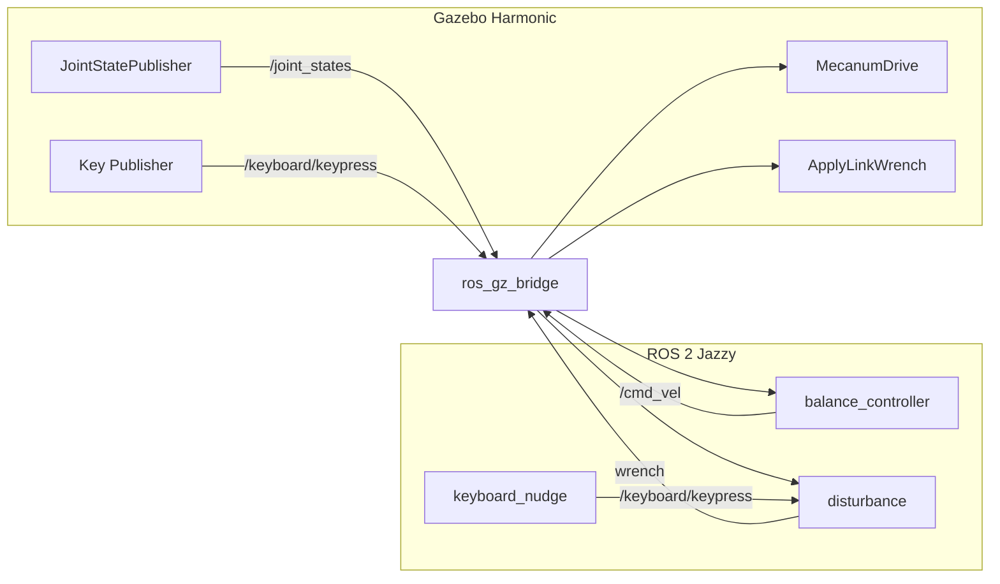

# Omni Pendulum Robot

A 2-DOF inverted pendulum balanced by a mecanum-wheeled **AgileX LIMO**, simulated in
**Gazebo Harmonic** and controlled with **ROS 2 Jazzy** on Ubuntu 24.04.

A 0.5 m pole with a ball on top sits on a free two-axis hinge on top of the robot. When the
pole starts to fall, the robot drives in that direction to get back underneath it. You can
nudge the pole with the arrow keys and watch the robot recover.

## Features

- **Omnidirectional balancing**: the pole can fall in any direction. The mecanum base drives
  forward, sideways or diagonally to catch it.
- **LQR controller with physical limits**: gains come from the pendulum's real mass and
  inertia. Separate limits on braking lean (3.4°), return speed (0.3 m/s), acceleration
  (6 m/s²) and top speed (2 m/s) stop the robot from overshooting after a strong push.
- **Continuous falling and catching**: gravity keeps tipping the pole. At start-up it falls
  freely to 8°; after that the robot lets go once the pole is back under control, catches it
  again at about 6°, and repeats. A nudge triggers an immediate catch.
- **Human-like manual nudges**: finger-tap pushes from the arrow keys in the Gazebo window or
  in a terminal, or exact pushes on a topic. There are no automatic nudges: one tiny start-up
  nudge starts the fall, and gravity keeps the cycle going.
- **Mecanum wheels in Gazebo Harmonic**: anisotropic wheel friction combined with Gazebo's
  MecanumDrive system.
- **Ground-truth odometry** for checking wheel slip.
- **Full documentation**: a 70-page [project guide](docs/omni_pendulum_project_guide.pdf)
  with the design history, control theory, test results and a line-by-line code walkthrough.

## Requirements

- Ubuntu 24.04
- [ROS 2 Jazzy](https://docs.ros.org/en/jazzy/Installation.html)
- Gazebo Harmonic plus the ROS–Gazebo bridge, xacro and robot_state_publisher:

```bash
sudo apt install ros-jazzy-ros-gz ros-jazzy-xacro ros-jazzy-robot-state-publisher
```

## Build

This repository is a complete colcon workspace. Clone it and build:

```bash
git clone https://github.com/<your-username>/<your-repo>.git ~/omni_pendulum_ws
cd ~/omni_pendulum_ws
source /opt/ros/jazzy/setup.bash
colcon build --symlink-install
source install/setup.bash
```

Every new terminal needs both `source` lines. To load them automatically, add them to `~/.bashrc`.

## Run

```bash
ros2 launch omni_pendulum_sim sim.launch.py
```

| Launch option | Effect |
|---|---|
| `gui:=false` | Run Gazebo without a window |
| `push:=false` | Turn off the start-up and manual nudges (the pole then stays upright) |
| `balance:=false` | Turn off the controller and watch the pole fall |

### Nudging the pole

**In the Gazebo window**: click on the 3D view, then:

| Key | Push |
|---|---|
| ↑ / ↓ | forward / back |
| ← / → | left / right |
| `+` / `-` | stronger / weaker (starts at 0.8 N) |

**In a terminal** (same keys, `q` to quit):

```bash
ros2 run omni_pendulum_sim keyboard_nudge
```

**With an exact force** (newtons; x = forward, y = left):

```bash
ros2 topic pub --once /nudge geometry_msgs/msg/Vector3 "{x: 0.5, y: 0.0}"
```

The robot recovers from nudges up to about 1.2 N at the top of the pole in every direction.

## How it works



1. Gazebo publishes the pendulum's pitch and roll angles and rates on `/joint_states`.
2. `balance_controller` treats each tilt axis as a cart-pole. It computes the base
   acceleration needed to get under the pole, integrates it into a velocity and publishes
   `/cmd_vel`.
3. Gazebo's MecanumDrive turns `/cmd_vel` into four wheel speeds. The wheels' diagonal
   friction lets the robot move in any direction.
4. `disturbance` applies the start-up and manual nudges through Gazebo's ApplyLinkWrench
   system. Each push is a short half-sine force pulse at a random height on the rod.

The controller is an LQR state feedback written as a cascade:

```
lean_ref = -(k_pos * position_error + k_vel * velocity_error) / k_theta   (limited)
accel    = k_theta * (theta - lean_ref) + k_omega * theta_rate             (limited)
```

The inner line keeps the pole up. The outer line brakes and returns the robot home by asking
for a small backward lean, and capping that lean is what prevents overshoot. For the full
derivation and the test results, see the [project guide](docs/omni_pendulum_project_guide.pdf).

## Repository layout

```
omni_pendulum_ws/
├── README.md
├── LICENSE
├── docs/
│   ├── omni_pendulum_project_guide.pdf   # full project documentation
│   └── source/                           # generator for the PDF
└── src/omni_pendulum_sim/                # the ROS 2 package
    ├── omni_pendulum_sim/
    │   ├── balance_controller.py         # balancing controller node
    │   ├── disturbance.py                # nudge generator node
    │   └── keyboard_nudge.py             # terminal arrow-key input
    ├── launch/sim.launch.py              # starts everything
    ├── urdf/robot.urdf.xacro             # LIMO + mecanum wheels + platform + pendulum
    ├── worlds/balance_world.sdf          # world with the ApplyLinkWrench system
    ├── config/gui.config                 # Gazebo layout: Key Publisher + closer camera
    ├── meshes/limo/*_lite.dae            # simplified LIMO meshes
    ├── setup.py, setup.cfg, package.xml  # package build files
    └── test/                             # flake8 / pep257 lint tests
```

## Tuning

Controller parameters can be overridden without editing code. For example:

```bash
ros2 run omni_pendulum_sim balance_controller --ros-args -p use_sim_time:=true -p max_lean_rad:=0.08
```

| Parameter | Default | Effect |
|---|---|---|
| `max_lean_rad` | 0.06 | Larger: shorter roll-out after a push, more lean the other way. Keep ≥ 0.05. |
| `max_return_speed` | 0.3 m/s | Speed of the drive back to the start point |
| `max_accel` | 6.0 m/s² | Must match what the wheels can deliver |
| `max_vel` | 2.0 m/s | Absolute speed limit |
| `engage_tilt_rad` | 0.14 | How far the pole falls before the very first catch |
| `catch_tilt_rad` | 0.1 | Tilt at which the robot catches the pole in each cycle. Larger: bigger swings, less margin. |
| `catch_rate` | 0.6 rad/s | Catch immediately if the pole moves faster than this (a nudge) |
| `release_tilt_rad`, `release_rate` | 0.015, 0.1 rad/s | How settled the pole must be before the robot lets go |

Nudge settings (`release_force`, `key_force`, `nudge_duration`, …) are parameters of the
`disturbance` node. All parameters are listed in the project guide.

## Tests

```bash
colcon test --packages-select omni_pendulum_sim
colcon test-result --verbose
```

## Troubleshooting

| Symptom | Fix |
|---|---|
| `Package 'omni_pendulum_sim' not found` | `source install/setup.bash` in that terminal |
| Robot missing, or "Moved backwards in time" warnings | A leftover Gazebo is running: `pkill -f "gz sim"`, then relaunch |
| Arrow keys do nothing in Gazebo | Click on the 3D view first, or use `keyboard_nudge` |
| Gazebo shows "not responding" | Wait a moment; on hybrid-GPU laptops, run Gazebo on the dedicated GPU |

## Credits

- The robot's chassis and wheel meshes and dimensions come from AgileX Robotics'
  [limo_ros2](https://github.com/agilexrobotics/limo_ros2) `limo_description` package. The
  meshes here are simplified versions of the originals. That repository does not declare a
  license, so the LIMO mesh files are not covered by this project's license; contact AgileX
  for terms before redistributing them.
- The mecanum drive, pendulum, controller, disturbance model and documentation are
  original to this project.

## License

[Apache License 2.0](LICENSE) (except the AgileX LIMO meshes; see Credits).
